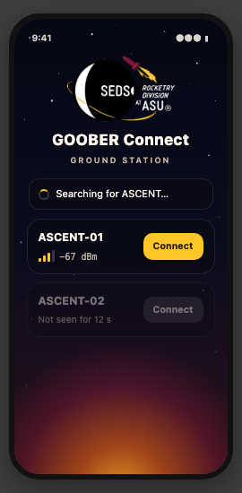
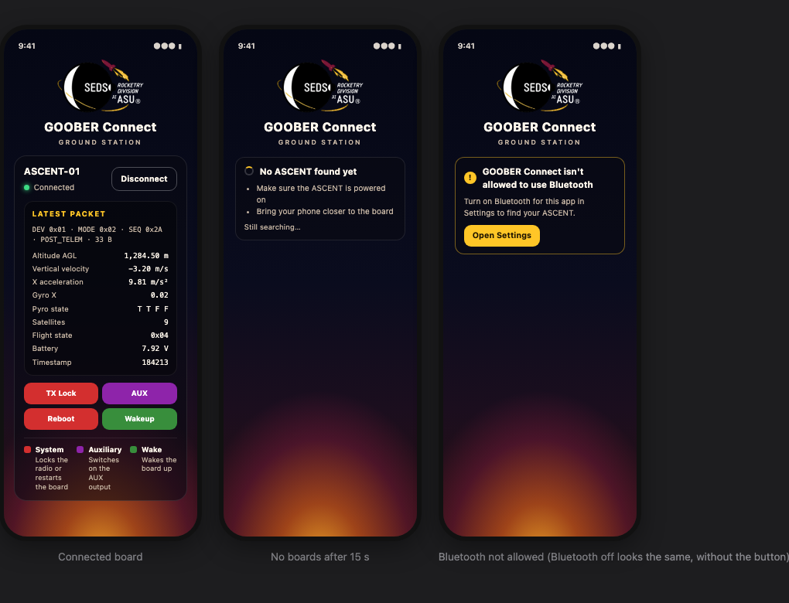

# Scan screen improvements and the Launch Glow look

- **Date:** 2026-10-15
- **Status:** Design approved; implementation not started
- **Platforms:** iOS and Android (shared Compose Multiplatform code, plus small platform pieces)



## Why

Before you connect to an ASCENT, the app shows a title and a list that stays blank until a board
is found. There's nothing to tell you whether Bluetooth is off, whether the app is allowed to use
it, or whether it's still searching. Once a board has been found, its card stays forever: it never
updates its signal reading and looks connectable even after the board is switched off.

This change makes that screen tell you what's going on, and gives the app a new look built around
the SEDS Rocketry Division at ASU logo. It's the first of three planned improvements; a home screen
and a pre-flight checklist come later, each with its own design.

## What you'll see

### Status line above the list

One message at a time, picked in this order:

| Situation | Message |
|---|---|
| Bluetooth is off | "Bluetooth is off. Turn it on to find your ASCENT." |
| The app isn't allowed to use Bluetooth | "GOOBER Connect isn't allowed to use Bluetooth", then "Turn on Bluetooth for this app in Settings to find your ASCENT." and an **Open Settings** button that opens the app's own settings page |
| The device has no Bluetooth LE | "This device doesn't support Bluetooth LE." |
| Bluetooth is starting up | "Starting Bluetooth…" |
| At least one board can be heard | No status line, just the cards |
| Searching, under 15 s since the scan started | Spinner + "Searching for ASCENT…" |
| Searching, 15 s or more | Spinner + "No ASCENT found yet", the tips "Make sure the ASCENT is powered on" and "Bring your phone closer to the board", and "Still searching…" |

"Can be heard" means a board that isn't greyed out (see below). Bluetooth off has no button
because iOS doesn't let apps open the Bluetooth settings page.

### Board cards (not connected)

- **Signal:** 0–4 bars and the reading, e.g. "−67 dBm", updated live from the board's broadcasts.
  Four bars at −60 dBm or stronger, three at −70, two at −80, one at −90, none below that.
  Readings are smoothed (`new = 0.7 × previous + 0.3 × reading`; the first reading is used as is)
  so the bars don't flicker.
- **Gone:** if a board hasn't been heard for **10 s**, its card dims, shows "Not seen for N s"
  (counting up once a second) and Connect is disabled. It returns to normal as soon as the board is
  heard again.
- Cards keep the current order (by name), so they don't jump around as signals change.

### Connected board



- Same information as today, restyled: the packet header (DEV, MODE, SEQ, message type, size) on
  one small line, then the telemetry values in two columns.
- No signal bars and never dimmed: boards stop broadcasting once connected and BlueFalcon can't read
  signal strength over a connection. A dropped link shows "Disconnected" as today.
- **Commands:** TX Lock and AUX, then Reboot and Wakeup, with their current colors. Below them, a
  key:
  - Red **System**: locks the radio or restarts the board
  - Purple **Auxiliary**: switches on the AUX output
  - Green **Wake**: wakes the board up
- **Apogee and Mains are removed.** Bluetooth can't reach a rocket at apogee, the protocol has no
  reply confirming these commands, and nothing in the app knows whether the board is armed. The
  `MSG_TYPE_REQ_POP_APOGEE`/`MAINS` entries stay in `goober.kt` because that file describes the
  board's protocol; the app just doesn't send them. The Pyro state readout stays.

### The look: Launch Glow

Always dark, whatever the phone's light/dark setting.

- **Background**, drawn in code:
  - Vertical gradient `#050714` → `#0A0C1E` (50%) → `#1B0E1E` (75%) → `#2A1012`.
  - A glow rising from the bottom edge: an ellipse 85% of the screen wide and 42% tall, centred
    just below the bottom, fading `rgba(255,170,40,.85)` → `rgba(255,110,30,.55)` (25%) →
    `rgba(140,29,64,.40)` (55%) → transparent (78%).
  - About 25 small fixed stars in the upper half (white, 0.4–1.2 dp, 25–90% opacity).
- **Colors:** text `#FFF7EC`, secondary text `#C9B8A6`, accent ASU gold `#FFC627` with `#1A1200` on
  it, cards `rgba(8,8,18,.58)` with a `rgba(255,255,255,.10)` border and 16 dp corners, empty signal
  bars `rgba(255,255,255,.18)`, connected dot `#3DDC84`.
- **Header:** the SEDS Rocketry logo (dark-mode version: white text, transparent background), then
  "GOOBER Connect" with "GROUND STATION" underneath.
- **Edge to edge:** the background fills the whole screen, behind the status bar and home
  indicator, while the content stays inside the safe area. Status-bar text is light on both
  platforms.
- **App name:** the home-screen and Settings name becomes "GOOBER Connect" on both platforms, so it
  matches the permission message. Today iOS shows "iosBlueFalconExampleMP" and Android has no label.

The logo's white background was removed in three versions, saved with this doc:
`seds-logo.png` (original colors, for light backgrounds), `seds-logo-dark.png` (text turned
white; the one the app uses) and `seds-logo-sticker.png` (white die-cut edge). Only the background
was removed; the white crescent, SEDS letters and moon inside the planet are kept, and the holes in
letters such as O, D and A are transparent. The source image is only 262 × 203 px, so a
higher-resolution or vector logo would look sharper.

## How it works

### Bluetooth status and starting the scan

New in the common code:

```kotlin
enum class BluetoothStatus { Ready, Off, NoPermission, Unsupported, Starting }

// Platform checks that BlueFalcon can't do for us.
interface PlatformBluetooth {
    fun problem(): BluetoothStatus?   // null = nothing wrong as far as the platform can tell
    fun openAppSettings()
}
```

- **Android** (`androidMain`): `problem()` returns `Unsupported` without an adapter, `NoPermission`
  without `BLUETOOTH_SCAN` and `BLUETOOTH_CONNECT` (Android 12+) or `ACCESS_FINE_LOCATION` (older),
  and `Off` if the adapter is disabled. `openAppSettings()` opens the app's details page. This is
  needed because BlueFalcon 2.2.4 always reports Ready on Android and its `scan()` never fails
  there.
- **iOS** (`iosMain`): `problem()` returns null. `openAppSettings()` opens
  `UIApplicationOpenSettingsURLString`.

The view model works out the status once a second and whenever BlueFalcon's `managerState` changes:

1. If `platformBluetooth.problem()` returns something, that's the status.
2. Otherwise, if `managerState` is `Ready`, the status is `Ready`.
3. Otherwise (iOS) it calls `scan()` and maps the exception: `BluetoothNotEnabledException` → `Off`,
   `BluetoothPermissionException` → `NoPermission`, `BluetoothUnsupportedException` →
   `Unsupported`, anything else → `Starting`. BlueFalcon only says Ready/NotReady, but `scan()`
   throws a specific exception for each iOS Bluetooth state, so this is how we learn why.

Whenever the status changes to `Ready` (including the first time), the view model calls `scan()`.
This keeps the crash fix from `ecba402`: never scan before Bluetooth is ready. It also restarts the
scan after Bluetooth is switched back on, and on Android it no longer scans before the permission
prompt is answered. That probably also fixes a crash on first launch on Android 12+, where
`startScan()` without permission throws; this is unconfirmed because Android can't be built on the
Mac used for this work.

### Broadcasts, signal and "last heard"

- `BleDelegate` also overrides `didDiscoverDevice` and sends a new
  `DeviceEvent.OnAdvertisement(macId, peripheral, rssi)`. BlueFalcon calls this for **every**
  broadcast on both platforms (iOS scans with "allow duplicates"; Android reports every scan
  result), each time with a fresh RSSI.
- The view model handles it for names containing "ASCENT" (same filter as today): it adds the board
  if new, otherwise it updates the smoothed RSSI and `lastSeenAt`, keeping the existing `connected`
  flag and peripheral object (which may already have discovered services). This replaces the
  `blueFalcon.peripherals` collector, so boards are added in one place.
- Time comes from `kotlin.time.TimeSource.Monotonic`, measured from when the view model starts. The
  state carries `now`, refreshed every second, so "Not seen for N s" and "No ASCENT found yet" update
  without a board in range.

State changes:

- `EnhancedBluetoothPeripheral` gets `rssi: Float?` and `lastSeenAt: Duration?`.
- `BluetoothDeviceState` gets `bluetoothStatus`, `scanStartedAt: Duration?` and `now: Duration`.

### The rules (one small file, unit-tested)

`ScanRules.kt` in `ble/presentation` holds pure functions and constants:
`GONE_AFTER = 10.seconds`, `NOT_FOUND_AFTER = 15.seconds`, `signalBars(rssi)`,
`smoothRssi(previous, reading)`, `isGone(sinceLastSeen, connected)`,
`scanMessage(status, audibleBoards, scanningFor)` and `bluetoothStatusFor(exception)`. These are what
the unit tests cover, and what to adjust after trying the real board.

### UI

- `App.kt`: draws `LaunchGlowBackground` full screen, then the header and `DeviceScanView` inside
  the safe area (`WindowInsets.safeDrawing`).
- `DeviceScanView.kt`: the status line and the cards.
- `FoundDeviceCard.kt`: signal bars, dimmed "Not seen" state, restyled connected panel, the four
  commands and the color key; Apogee/Mains buttons and dialogs removed.
- Theme: one Launch Glow color scheme on both platforms. Android's status and navigation bars become
  dark with light icons instead of the theme's primary color.
- Logo: `seds-logo-dark.png` added as a Compose resource (`shared/src/commonMain/composeResources/drawable/`).
- iOS host: `ContentView` adds `.ignoresSafeArea()` and `.preferredColorScheme(.dark)`;
  `Info.plist` gets `CFBundleDisplayName` "GOOBER Connect". Android manifest gets
  `android:label="GOOBER Connect"`.

### Small fix along the way

`AppModule.blueFalcon` is a getter that builds a new `BlueFalcon` on every read. It's read once
today, but this change adds more to `AppModule`, so it becomes a stored property. `AppModule` also
gains `platformBluetooth`, which `App.kt` passes to the view model.

## Testing

- **Unit tests** (`shared/src/commonTest`, the project's first) for everything in `ScanRules.kt`:
  bar thresholds and edges, smoothing, connected boards never gone, the 10 s and 15 s boundaries,
  status priority, exception mapping. Run on the iOS Simulator:
  `./gradlew :shared:iosSimulatorArm64Test`.
- **On an iPhone**, after building and installing:
  1. Bluetooth off in Control Center → "Bluetooth is off"; on again → searching starts.
  2. Settings → GOOBER Connect → Bluetooth off → "isn't allowed"; Open Settings goes to the right page.
  3. Board off → "Searching…", then "No ASCENT found yet" after 15 s.
  4. Board on → card appears; bars drop when walking away and recover when coming back.
  5. Board switched off → card dims after 10 s with a counting "Not seen"; Connect disabled;
     returns when the board is back on.
  6. Connect → telemetry and the four commands work as before; disconnect.
  7. Looks: background behind the status bar and home indicator, light status-bar text, in both
     light and dark phone settings.
- **On Android** (needs someone with an Android phone): the same list, plus a fresh install on
  Android 12+ to check the first-launch permission flow.

## Not included / open questions

- Questions for the firmware owner: does the board act on 0x69/0x6A and only when safe? Which pyro
  channel is which? `goober.kt` has two different sets of command codes (e.g. Reboot is 0x82 in the
  unused constants at the top and 0x1E in what the buttons send); which is current?
- There's an "AUX off" message (0x0B) but no button for it; unchanged here.
- Older Android phones (11 and below) need Location turned on to find Bluetooth devices; the app
  doesn't check for that.
- The numbers (10 s, 15 s, signal levels) may need tuning once tried with the real board.
