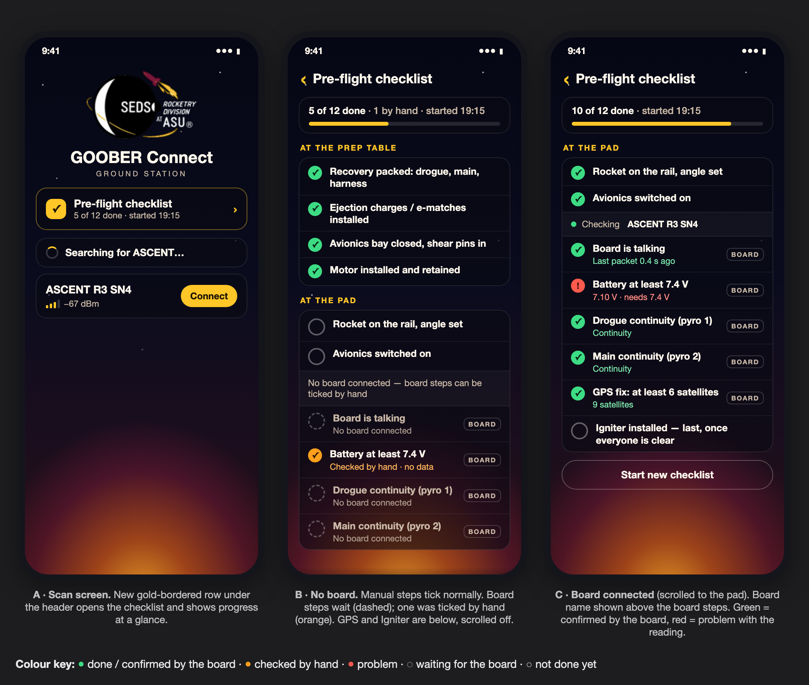

# Pre-flight checklist

- **Date:** 2026-10-22; revised 2026-10-26 to use the team's own checklist
- **Status:** Implemented on branch `preflight-checklist`; checked on iPhone without a board; live readings and Android not yet checked
- **Platforms:** iOS and Android (shared Compose Multiplatform code, plus small platform pieces)
- **Builds on:** the scan screen work on branch `scan-screen-redesign`
  ([2026-10-15-scan-screen-design.md](2026-10-15-scan-screen-design.md))



Where the mockup and the text below differ, the text wins.

## Why

The team already flies with a paper checklist. It has three sections, 29 steps, and an "Initial"
and "Time/Date" box next to every step. Its step 9.11 asks the arming person at the pad to confirm
"good telemetry, continuity, battery voltage, and GPS". The ASCENT already sends exactly those
values, but today the app only lists the raw numbers on the connected card.

This puts the team's checklist in the app:
- Every step is ticked by a person and stamped with their initials and the time.
- The live ASCENT readings appear under the steps that ask about them.
- It's a guide and a record. It never sends anything to the board, and it doesn't unlock or block
  anything.

It's the second of three planned improvements, after the scan screen and before the home screen.

## What you'll see

### Opening it

- **Scan screen:** a new row under the header (gold border), **Pre-flight checklist**. Its progress
  line reads:
  - "Not started · 29 steps" when nothing is ticked;
  - "5 of 29 done · started 7:15 PM" part-way;
  - "All 29 steps done" at the end.

  Tapping the row opens the checklist full screen.
- **Leaving:** the checklist has a back arrow and the title "Pre-flight checklist". The arrow
  returns to the scan screen, and on Android the system Back button does the same. iOS has no
  system back gesture here, so the arrow is the only way back. Going back doesn't disconnect the
  board.
- **Layout:** the top bar and the progress card stay put; the steps scroll underneath.
  **Start new checklist** is at the end of the list.

### The steps

All 29 steps live in one file, `ChecklistSteps.kt`, which is the file the team edits.
- Each step's id is its number on the paper: `8.1`…`8.8`, `9.1`…`9.15`, `G.1`…`G.6`. The id is
  also what gets saved, so keep ids unchanged when editing wording.
- On screen, each section has a gold label: "8 · ONSITE PREFLIGHT READY", "9 · PRE-LAUNCH",
  "G · LAUNCH". Steps show their number within the section ("1.", "2.", …), as on paper.

The wording is the team's, with only these fixes:
- **Spelling:** "b sure" → "Be sure" (8.3), "pre-Lauch" → "pre-Launch" and "to to" → "to" (G.1),
  "personel" → "personnel" (9.10, 9.11, 9.14, 9.15), "pad ." → "pad." (9.1).
- **Capitals:** each sentence starts with a capital letter. Product names are capitalised:
  Ascent, Featherweight, Blue Raven, Nomex.
- **References:** "(V.F.9)" and "V.I.1" stay as written.

**8 · ONSITE PREFLIGHT READY**

| Id | Step |
|---|---|
| 8.1 | Ensure that all batteries being used are fully charged the day of flight. |
| 8.2 | Install and power on payload into nosecone 6 radial M3 screws |
| 8.3 | Install nosecone onto upper airframe with 4 M6 radial bolts. Be sure to use loctite |
| 8.4 | Install lower airframe onto the fin can. Be sure to use loctite |
| 8.5 | Attach first quick-link of the drogue to the bottom of the avbay and take off tape from the Nomex |
| 8.6 | Attach second quick link to the top of the avbay. Ensure the tape is removed from the Nomex on the mains |
| 8.7 | Unshort e-matches, trim ends to length, and attach securely to pass-through bolts. If needed, tape ends with electrical tape. |
| 8.8 | Stack all sections of the rocket. Insert four M3 nylon shear pins into the avbay through the upper airframe and four M3 nylon shear pins into the avbay through the lower airframe. |

**9 · PRE-LAUNCH**

| Id | Step |
|---|---|
| 9.1 | Drive the rocket to the launch pad. |
| 9.2 | Once at the pad we will ensure a clear radius around the rocket so that exhaust gasses do not cause a fire |
| 9.3 | Once the area is safe to launch from, we will lower the rail and insert the rocket. |
| 9.4 | Then raise the rocket to be vertical. |
| 9.5 | With the vehicle vertical, only the minimum personnel will approach the vehicle for further procedures. The rest of the group will remain back at a good standoff distance. |
| 9.6 | Next the nitrous lines will be hooked up to the tank. |
| 9.7 | Ensure that the nitrous pressure is at optimal levels, ideally 750 PSI |
| 9.8 | Once given clearance, a squirt leak test will be performed. The remainder of the checklist is only to be continued if the leak test was nominal. |
| 9.9 | (One person with a handheld radio) Once the rocket is vertical and in launch orientation, we will arm the flight computers one at a time, starting with the Ascent avionics system. |
| 9.10 | Once Ascent is armed, the arming personnel is to observe the beep sequence of Ascent for any error beeps. |
| 9.11 | After Ascent is booted up, the arming personnel is to radio ground control from pad to ensure good telemetry, continuity, battery voltage, and GPS. |
| 9.12 | The Featherweight GPS will be armed for flight after we are assigned a frequency. |
| 9.13 | Next, the Blue Raven is armed for flight. |
| 9.14 | Arming personnel must listen for the beeps from the Raven, and ensure that we still have GPS lock with the Featherweight and Ascent. |
| 9.15 | Once all controllers and trackers are confirmed armed, the final pad personnel will wire the ignitors to the launch controller. |

**G · LAUNCH**

| Id | Step |
|---|---|
| G.1 | Complete pre-Launch checklist and return to the flight line. (V.F.9) |
| G.2 | Check to see if live video is still transmitting |
| G.3 | Ensure the Featherweight and Ascent is still tracking. Failure of one system results in a scrub, follow V.I.1. |
| G.4 | Once avionics is go for launch, and we are given permission by the LCO, the fill for the rocket can be started. A rough time estimate for fill must be provided to the LCO |
| G.5 | Once the rocket is confirmed full, the pad is armed and the fill valve is closed. |
| G.6 | Once we are given the go for launch, the launch button can be pressed. Go Solar Flare |

### Ticking, initials and time

- **Ticking:** every step is ticked by a person.
  - Tapping a step ticks it: a green tick, with a stamp underneath, e.g. "CR · 7:42 PM". The time
    is in the phone's format.
  - Tapping it again unticks it and clears the stamp.
- **Initials** sit on the right of the progress card, under a small "INITIALS" caption, and are
  stored on the phone.
  - Tapping them opens the **Your initials** dialog: "Saved with each step you tick.", a text field,
    and **Cancel** and **Save**.
  - Only letters are kept, in capitals, up to 4. **Save** needs at least one letter.
  - Initials are kept across checklists. Changing them doesn't change stamps already made.
  - With no initials set, the chip shows "—", and the first tick opens the dialog before ticking.
    **Cancel** leaves the step unticked.

### Live readings

The readings come from the connected ASCENT. Steps 9.11, 9.14 and G.3 show a small block of them
under their text:

| Step | Readings shown |
|---|---|
| 9.11 | Battery, Drogue continuity, Main continuity, GPS |
| 9.14 | GPS |
| G.3 | GPS |

The app can't read the Featherweight or the Blue Raven, so a person checks those as before.

**The block's first line** says which board it is and how fresh its data is. This covers the
"telemetry" part of 9.11 and the "still tracking" part of G.3.

| Situation | First line |
|---|---|
| No connected board | "No board connected" |
| More than one connected board | "Connect only one board" |
| Connected, no telemetry yet | "ASCENT R3 SN4 · no data yet" |
| Last telemetry older than 3 s | "ASCENT R3 SN4 · last data 12 s ago" (whole seconds) |
| Fresh telemetry | green dot + "ASCENT R3 SN4 · last packet 0.4 s ago" (one decimal) |

**Then one row per reading,** with the label on the left and the value on the right. With fresh
telemetry, values are green when fine and red when there's a problem. Otherwise every value is a
grey "—", so the app never judges the board on old data.

| Reading | Fine (green) | Problem (red) |
|---|---|---|
| Battery | "7.92 V" | "7.10 V · needs 7.4 V" |
| Drogue continuity | "Continuity" | "No continuity" |
| Main continuity | "Continuity" | "No continuity" |
| GPS | "9 satellites" | "4 satellites · needs 6" |

**The limits** sit in `ChecklistSteps.kt`:

| Setting | Default | Why this value |
|---|---|---|
| `MIN_BATTERY_VOLTS` | 7.4 | Nominal voltage of a 2-cell LiPo; to be confirmed for the battery the team flies |
| `MIN_SATELLITES` | 6 | A common bar for a solid fix (4 is the minimum for any fix) |
| `FRESH_TELEMETRY` | 3 s | How recent the last telemetry packet must be |
| `DROGUE_PYRO_CHANNEL` | 1 | A guess; which channel is which is an open firmware question |
| `MAIN_PYRO_CHANNEL` | 2 | Same |

Pyro channel *n* is bit *n − 1* of the telemetry's `pyroState`, the mapping the connected card
already uses. Battery volts are the raw value ÷ 2500, also as on the card. The **flight state** byte
isn't used, because nothing in the app says what its values mean.

**Naming the board matters.** On 2026-10-15 a nearby board was mistaken for a test device.

### Ticking with a red reading

If any of a step's readings is red when someone ticks it, the app asks first.
- The dialog is titled "Tick 9.11 anyway?".
- It lists each problem on its own line, e.g. "Battery: 7.10 V · needs 7.4 V".
- It has **Cancel** and **Tick anyway** buttons.
- If initials are also missing, the initials dialog comes first, then this one.
- Grey readings ("—") don't ask, since that's normal with no board connected. Unticking never asks.

### Progress, finishing and starting again

- **Progress card:**
  - **Line 1, bold:** "18 of 29 done", or "All 29 steps done" at the end.
  - **Line 2:** "started 7:15 PM", once a start time exists.
  - **Bar:** gold, turning green when every step is done.
- **Start time:** set by the first tick on an empty checklist, which is the first time it's used
  and after each "Start new checklist". It's shown in the phone's time format.
- **Old checklist:** if the start time is more than 12 hours ago, a banner at the top says
  "Started 14 h ago. Start a new checklist?" with a **Start new** button.
- **Start new checklist** (bottom of the list, or the banner's button) asks first.
  - The dialog says "Start a new checklist?" / "This clears every tick, with its initials and time.
    Your initials stay set.", with **Cancel** and **Start new**.
  - Starting new clears all ticks and the start time.

### Saving

- The ticks are saved on the phone straight after every change, along with each tick's initials
  and time, and the start time. They survive the app being closed or the phone restarting. The
  initials are saved separately.
- Readings are never saved; they're worked out from live data every time.
- If the saved data can't be read, the app starts with an empty checklist instead of crashing.
  Ticks for step ids that no longer exist are ignored. Data saved by the earlier draft of this
  design is ignored too.

### Colours

Same Launch Glow theme as the scan screen, plus:
- **Ticked:** green tick `#3DDC84`; the stamp text is `#7EE8AE`.
- **Not ticked:** empty ring `rgba(255,255,255,.35)`.
- **Readings:** fine `#7EE8AE`, problem `#FF8A80`, no fresh data grey "—".
- **Reading block:** background `rgba(0,0,0,.28)`, border `rgba(255,255,255,.07)`.
- **Gold `#FFC627`:** the section labels, the progress bar, the back arrow, the initials and the
  entry row's border.

## How it works

### New files

In `shared/src/commonMain/kotlin/com/example/bluefalconcomposemultiplatform/checklist/`:

- **`ChecklistSteps.kt`:**
  - the sections (code and label);
  - the 29 steps (id, section, number, text, readings);
  - the readings (battery, drogue continuity, main continuity, GPS);
  - the five settings.
- **`ChecklistRules.kt`:** small functions with no UI and no platform code, all unit-tested:
  - which board to check from the Bluetooth view model's devices (none, one or too many) and how
    old its last telemetry is;
  - a reading block's first line and each reading's value;
  - battery volts and pyro-channel continuity from a telemetry payload;
  - what a tap does: untick, ask for initials, ask to confirm (with the red readings), or tick;
  - ticks with their initials and time, and cleaning up typed initials;
  - progress and the scan-screen line;
  - the 12-hour rule;
  - saving and loading the ticks as text.
- **`ChecklistStorage.kt`:** a tiny storage interface that saves and loads text by key. iOS uses
  `NSUserDefaults` (`IosChecklistStorage` in `iosMain`); Android uses `SharedPreferences`
  (`AndroidChecklistStorage(context)` in `androidMain`). Keys are `preflight-checklist` for the
  ticks and `preflight-initials` for the initials. `AppModule` provides the storage as
  `checklistStorage`, the same way it provides `platformBluetooth`.
- **`ClockTime.kt`:** `expect fun currentEpochMillis(): Long` and
  `expect fun formatClockTime(epochMillis: Long): String`, with small `iosMain` and `androidMain`
  versions. Kotlin 2.0.20's standard library has no wall clock, and this avoids adding a library.
- **`ChecklistViewModel.kt`:** holds the ticks and the initials in `StateFlow`s. It loads both on
  creation and saves on every change. Its actions are tick, untick, set initials and start new.
- **`ChecklistScreen.kt`:** the checklist screen, its dialogs, and the entry row used on the scan
  screen.
- **`PlatformBackHandler`:** an `expect` composable. Android uses `BackHandler` from
  `androidx.activity.compose`, which is already a dependency; iOS does nothing.

The saved ticks are one line of text, e.g.
`v2;started=1792721854000;tick=8.1,CR,1792721854000;tick=8.2,CR,1792722214000`. Anything that
doesn't parse gives an empty checklist.

### Changes to existing code

- **`EnhancedBluetoothPeripheral`:** gains `lastTelemetry` (the latest telemetry payload) and
  `lastTelemetryAt` (when it arrived, on the view model's clock).
- **`BluetoothDeviceViewModel`:** when a read gives a telemetry packet, it sets those two fields and
  refreshes the state's `now`, so the packet's age is never negative. Other packet types don't touch
  them. The existing `parsedPackets` and the connected card are unchanged.
- **`App.kt`:**
  - Keeps which screen is showing (scan or checklist) and draws it over the Launch Glow background.
  - The scan screen shows the header, the entry row and the device list.
  - The checklist view model is created next to the Bluetooth one.
- **`AppModule`** (common and both platforms): gains `checklistStorage`.
- **`Color.kt`:** gains the checklist colours.

### Data flow

```
Bluetooth view model ─(connected boards, latest telemetry, its age)─► rules ─► reading blocks ─┐
                                                                                                 ├─► ChecklistScreen
Checklist view model ─(ticks with initials and time, start time, initials)◄──► storage ─────────┘
```

The checklist never talks to Bluetooth directly; it only reads what the Bluetooth view model already
knows. Reading blocks are recalculated whenever that state changes. Its `now` refreshes at least once
a second, so a board that goes quiet turns its readings grey about 1 s after its last packet passes
3 s.

## Testing

- **Unit tests** in `shared/src/commonTest/.../checklist/`, run on the iOS Simulator with
  `./gradlew :shared:iosSimulatorArm64Test`:
  - **Steps:** 29 steps with unique ids; 8, 15 and 6 per section; readings attached to 9.11, 9.14
    and G.3 only.
  - **Readings:**
    - Battery: raw 18500 (7.40 V) is fine, raw 18475 (7.39 V) is a problem.
    - Continuity: channels 1 and 2 read the right bits.
    - GPS: 6 satellites fine, 5 a problem.
    - Wording, as in the tables above.
  - **First line and freshness:**
    - Exactly 3 s old is still fresh; older shows "last data N s ago" with grey values.
    - No telemetry shows "no data yet"; 0 and 2 boards show their own lines.
    - Age is never negative.
  - **Tapping:**
    - A ticked step unticks.
    - No initials → ask for initials.
    - A red reading → ask to confirm, listing every problem.
    - Grey readings → tick straight away.
  - **Ticks:** a tick stamps the initials and time; the first tick sets the start time; unticking
    keeps it. Typed initials are cleaned up: letters only, capitals, at most 4.
  - **Progress:** progress text, the scan-screen line, and the 12-hour rule.
  - **Saving:**
    - Saving and loading round-trip.
    - Unreadable text and the draft's `v1` format both give an empty checklist.
    - Unknown ids and broken tick entries are dropped.
  - **View model:** loads what was saved; ticking, setting initials and starting new each save
    straight away; starting new keeps the initials.
- **On the iPhone, no board needed:**
  1. The scan screen shows "Not started · 29 steps"; tapping opens the checklist; the back arrow
     returns.
  2. **First tick:** tap 8.1. The initials dialog appears; enter "CR" and Save. 8.1 shows a green
     tick and "CR · *time*", and the progress card says "1 of 29 done" with "started *time*".
  3. **Untick:** tap 8.1 again. The tick and stamp clear; the start time stays.
  4. **Change initials:** tap the initials chip, change them, then tick another step. The new step
     gets the new initials; earlier stamps keep the old ones.
  5. **Readings without a board:** 9.11's block says "No board connected" with grey "—" values.
     Ticking 9.11 doesn't ask anything.
  6. **Saving:** swipe the app away and reopen it. The ticks, stamps, start time and initials are
     still there, and the scan-screen row shows the progress.
  7. **Start new checklist:** Cancel keeps everything. Start new clears the ticks but keeps the
     initials.
  8. **Looks:** the screens match the mockup.
- **With a real board** (needs telemetry working first, see below):
  1. Before connecting, check the card shows the board name you expect.
  2. Connect. 9.11's block names the board, shows "last packet …", and its readings turn green or
     red with real values.
  3. **Red reading:** if any reading is red, ticking 9.11 asks "Tick 9.11 anyway?" listing the
     problems. Cancel leaves it unticked; Tick anyway ticks it.
  4. **Board off:** switch the board off. Within about 4 s the blocks say "last data N s ago" with
     grey values.
- **On Android** (needs someone with an Android phone): the same lists. Also check that the system
  Back button returns to the scan screen.

## Not included / open questions

- **Telemetry isn't confirmed yet.** On 2026-10-15 the connected card showed "No data received" from
  ASCENT R3 SN4. Until that's solved, the reading blocks will say "no data yet" and the team checks
  9.11 by radio, as on paper. Questions for the firmware owner:
  - Does the board answer reads on `0x0001` with telemetry, or push it as notifications?
  - Does it need **Wakeup** before it sends data?
- **Values to confirm with the team:** the battery type behind 7.4 V, which pyro channels are drogue
  and main, and the satellite bar.
- **Flight state:** could add a reading ("board in pad/idle state") once the firmware owner says
  what its values mean.
- **Featherweight and Blue Raven** can't be read by the app.
- **Gates aren't enforced.** 9.8 (stop if the leak test isn't nominal) and G.3 (scrub on failure)
  are shown as written; the app doesn't stop anyone ticking further.
- **One phone, one checklist.** Ticks aren't shared between phones, so ground control can't see the
  pad phone's ticks.
- **No export.** There's no export or print of a finished checklist yet. That's a natural follow-up,
  since the paper form is a record.
- **Not included:** editing steps in the app, or more than one checklist at a time.
- **Phone clock:** the 12-hour rule uses the phone's clock, so changing the clock or time zone
  affects it.
- **Android time format:** on Android, times follow the phone's language (e.g. "7:15 PM") rather
  than its separate 24-hour switch, which needs a `Context` that the clock function doesn't have.
