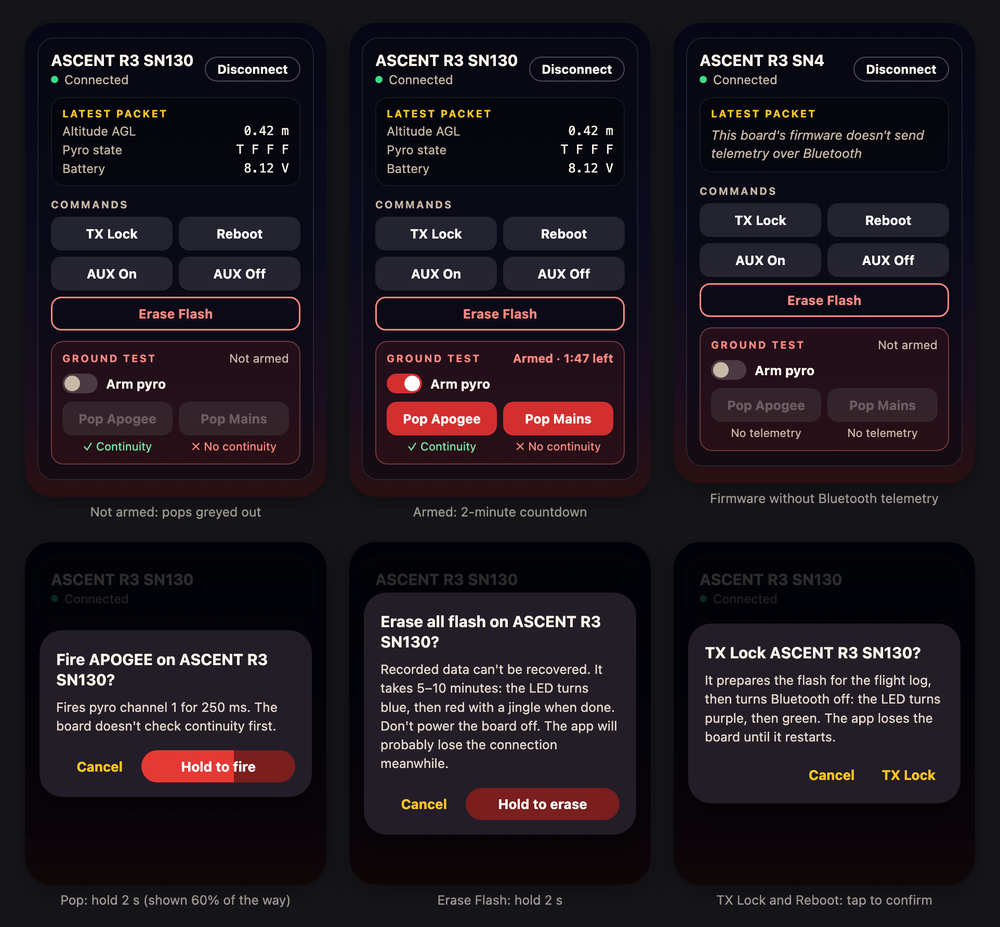

# Board commands

- **Date:** 2026-11-01
- **Status:** Design approved; not implemented yet
- **Platforms:** iOS and Android (shared Compose Multiplatform code)
- **Builds on:** the pre-flight checklist work on branch `preflight-checklist`
  ([2026-10-22-preflight-checklist-design.md](2026-10-22-preflight-checklist-design.md))
- **Branch:** `board-commands`, from `preflight-checklist`

Where the mockup and the text below differ, the text wins.

## Why

The connected card has four command buttons today: TX Lock, AUX, Reboot and Wakeup. None of them does
what its label says, because they send codes from an older version of the protocol:

| Button | Sends | What current firmware does with it |
|---|---|---|
| TX Lock | 20 | VOLTAGE: nothing |
| AUX | 10 | AUX_OFF: switches AUX off, on the branches that implement it |
| Reboot | 30 | Rejects it |
| Wakeup | 107 | Rejects it |

That's on packet firmware (see below). First-byte firmware, which includes the build flown on 3/8/2026,
rejects all four, because the app's packets start with 0x69.

The team's web configurator (the ASCENT Configurator) has seven buttons: TXLOCK, ERASE FLASH, REBOOT,
POP APOGEE, POP MAINS, AUX ON and AUX OFF. The team uses the pops for ground tests. The website's packets
only work on packet firmware.

The card's telemetry readings never show on current firmware either, so the checklist's live readings
never fill in.

This change:
- gives the app the website's seven buttons, with the firmware's codes, in a packet every firmware
  branch accepts;
- puts the two pops behind an arm switch and a press-and-hold, and Erase Flash behind a press-and-hold;
- decodes the telemetry that current firmware sends, and says so when a board's firmware sends none.

## What the firmware does

Read on 2026-11-01 from every branch of `github.com/SEDS-RD-ASU/ascent-r3-firmware`, its GOOBER library
(`github.com/abdulziaa/goober`, commit 89449ea) and `github.com/SEDS-RD-ASU/ascent-r3-drivers`. Every
branch with Bluetooth reports firmware "1.0.0", so the version string doesn't tell them apart.

### Command numbers

The firmware's message classes are a C enum (`ascent_message_classes_t` in `main/command/command.h`),
numbered the same on every branch:

| Code | Name | Button | What the board does |
|---|---|---|---|
| 4 | REBOOT | Reboot | Restarts |
| 5 | PYRO1 | Pop Apogee | Fires pyro channel 1 for 250 ms, skipping the continuity check |
| 6 | PYRO2 | Pop Mains | Fires pyro channel 2 the same way |
| 9 | AUX_ON | AUX On | Switches AUX on, only on `irec-dev`, `fsm-unique-counters-dev` and `event-logging-dev` |
| 10 | AUX_OFF | AUX Off | Switches AUX off, on the same branches |
| 12 | WAKE_UP | — | Nothing, on every branch |
| 13 | TXLOCK_ON | TX Lock | Erases the next flash bank for the flight log (LED purple, then a jingle), turns Bluetooth off, LED green |
| 21 | TELEMETRY | — | The class of the telemetry packets the board sends |
| 22 | ERASE_FLASH | Erase Flash | Erases the whole flash chip in 5–10 minutes (LED blue and a beep; red and a jingle when done) |

The pops don't check the flight state or any arming either, so the app's arm switch and hold are the
only safeguards. After TX Lock the board's Bluetooth is off, so it takes no Bluetooth commands.

### Two kinds of firmware

| | First-byte firmware | Packet firmware |
|---|---|---|
| Branches | `flight` (V1.0.0, flown 3/8/2026), `dev`, `abdul-dev`, `airbrakes`, `daq-dev`, `fast-dev`, `Hitl-Testing`, `imu-gravity-vector-dev`, `mode-selection-dev` | `irec-dev`, `fsm-unique-counters-dev`, `event-logging-dev`, `command-telemetry-dev` |
| A write | Runs the command in the first byte and ignores the rest | Decodes a GOOBER packet and runs its MSG_CLS; rejects a packet whose length doesn't match its header |
| A read | One byte: 25 × the battery's whole volts | A GOOBER packet with class 21 (TELEMETRY) and the 34-byte telemetry payload |

Reboot, TX Lock and Erase Flash do their work inside the Bluetooth write, before the board acknowledges
it. Reboot and TX Lock end the connection. Erase Flash freezes the board's Bluetooth for 5–10 minutes.

### GOOBER packets

- Header: DEV_ID, DEV_MODE, SEQ_ID, MSG_CLS, PAYLOAD_LENGTH, then the payload. No checksum.
- Decoding only checks lengths: at least 5 bytes, at most 255, a payload length of at most 250, and
  exactly 5 + payload length in total. It doesn't check DEV_ID, DEV_MODE or SEQ_ID.
- DEV_MODE: bits 0–1 transmission mode (1 = simplex), bit 2 intent, bit 3 size, bit 4 checksum, bit 5
  command-only; bits 6–7 reserved.
- The website sends `[255, 33, 0, code, 0]`: DEV_ID 255, simplex + command-only, no payload. On
  first-byte firmware that runs command 255, which is rejected.

### Telemetry payload

Only packet firmware sends it. 34 bytes, little-endian, laid out like the C struct with its padding:
timestamp (u32), latitude (i32), longitude (i32), altitude AGL (f32), vertical velocity (f32),
Y acceleration (f32), Y gyro (f32), pyro state (u8; bit n−1 is continuity on channel n), satellites
(u8), flight state (u8), one padding byte, battery (u16, volts × 2500). The app already decodes this
layout. Only the class and two field names change.

## What you'll see

### The card

A connected card shows the commands once characteristic 0x0001 has been found, as today. Under
"Latest packet":
- **Commands:** TX Lock and Reboot, then AUX On and AUX Off, as plain buttons in two rows. Erase Flash
  goes across the full width with a red outline.
- **Ground test:** a red-tinted box with the "Arm pyro" switch, its status ("Not armed" or
  "Armed · 1:47 left"), and Pop Apogee and Pop Mains as solid red buttons. Until the board is armed, the
  pops are greyed out and can't be tapped.
- Under each pop, that channel's continuity from the board's telemetry: "✓ Continuity" in green,
  "✗ No continuity" in red, or "No telemetry" in grey when no telemetry has arrived in the last
  3 seconds (the checklist's rule). Apogee is channel 1, Mains channel 2.
- The colour key under today's buttons goes. Red is kept for Erase Flash and the pops, so red means
  "can't be undone".

### Arming

- The switch arms that board only, for 2 minutes. The status counts down in minutes and seconds.
- The 2 minutes are measured on the phone's wall clock, so they keep running while the phone is locked.
  If the clock goes backwards, the board counts as not armed.
- Arming ends early when the switch is turned off, the board disconnects, or a pop is sent.
- When asked to send a pop, the view model checks that the board is armed at that moment, whatever the
  screen shows, and refuses otherwise.

### Dialogs

Every dialog names the board as the card shows it.

| Command | Title | Text | Buttons |
|---|---|---|---|
| Pop Apogee | Fire APOGEE on {board}? | Fires pyro channel 1 for 250 ms. The board doesn't check continuity first. | Cancel · Hold to fire |
| Pop Mains | Fire MAINS on {board}? | Fires pyro channel 2 for 250 ms. The board doesn't check continuity first. | Cancel · Hold to fire |
| Erase Flash | Erase all flash on {board}? | Recorded data can't be recovered. It takes 5–10 minutes: the LED turns blue, then red with a jingle when done. Don't power the board off. The app will probably lose the connection meanwhile. | Cancel · Hold to erase |
| TX Lock | TX Lock {board}? | It prepares the flash for the flight log, then turns Bluetooth off: the LED turns purple, then green. The app loses the board until it restarts. | Cancel · TX Lock |
| Reboot | Reboot {board}? | It restarts, and the app loses the connection. Reconnect when it shows up again. | Cancel · Reboot |

AUX On and AUX Off have no dialog. A tap sends them.

- **Hold buttons:** while pressed, a brighter fill grows across the button for 2 seconds. Letting go
  before it's full empties it and sends nothing. When it's full, the command is sent and the dialog
  closes.
- A dialog closes by itself when the board disconnects. A pop's dialog also closes when the arming ends.
- There's no "Sent" message. The firmware never replies, and Reboot, TX Lock and Erase Flash freeze or
  cut the board's Bluetooth before it acknowledges the write. The board's LEDs and sounds confirm what
  happened, which is why the dialogs describe them.

### Telemetry on the card

- **Packet firmware:** the readings appear. The header line names the class ("TELEMETRY"), or shows its
  hex value if the app doesn't know it.
- **First-byte firmware:** "This board's firmware doesn't send telemetry over Bluetooth" replaces
  "No data received".
- "X acceleration" and "Gyro X" become "Y acceleration" and "Gyro Y", matching the firmware.
- The checklist's live readings fill in for boards on packet firmware, with no checklist changes.

## How it works

No new libraries.

### The packet

Every command is sent as five bytes: `[code, 0x21, 0x00, code, 0x00]`.
- Packet firmware reads a GOOBER packet: DEV_ID = code (not checked), DEV_MODE 0x21 (simplex +
  command-only, as on the website), SEQ_ID 0, MSG_CLS = code, no payload.
- First-byte firmware runs the first byte, which is also the code.

So each command does the same thing on every branch. A comment at the packet builder explains this.

The bytes are written with BlueFalcon's `writeCharacteristicWithoutEncoding` (a write with response).
The `writeCharacteristic` versions that take a String or a ByteArray pass the bytes through UTF-8 text
encoding, which garbles any byte of 0x80 or more. Today's codes stay below that, but nothing should
depend on it.

The sequence around the write stays as it is: stop the read loop, wait 200 ms, write, and restart reads
when the write is acknowledged or after 2 seconds.

### New files

- **`shared/src/commonMain/.../ble/presentation/CommandRules.kt`:** pure rules with unit tests.
  - `Confirmation` (None, Tap, Hold, ArmAndHold) and `BoardCommand` (TX_LOCK, REBOOT, AUX_ON,
    AUX_OFF, ERASE_FLASH, POP_APOGEE, POP_MAINS). Each command has a message class, a label, a
    confirmation and, for the pops, a pyro channel.
  - `commandPacket(command)`: the five bytes above.
  - `PYRO_ARM_DURATION` (2 minutes) and `HOLD_TO_CONFIRM` (2 seconds).
  - `armedTimeLeft(armedAtMillis, nowMillis)`: the time left, or null when the board isn't armed, the
    time is up, or the clock went backwards.
  - `canSend(command, armedTimeLeft)`: false for a pop with no time left.
  - `formatTimeLeft(timeLeft)`: "1:47". It rounds up, so it reads 2:00 right after arming.
  - `PopContinuity` (Yes, No, NoTelemetry) and `popContinuity(channel, telemetry, telemetryAt, now)`,
    using the checklist's `hasContinuity` and `FRESH_TELEMETRY`.
- **`.../ble/presentation/component/CommandPanel.kt`:** the Commands group, the ground-test box and the
  dialogs, moved out of `FoundDeviceCard.kt` (400 lines today).
- **`.../ble/presentation/component/HoldToConfirmButton.kt`:** the press-and-hold button.
- **Tests:** `shared/src/commonTest/.../ble/presentation/CommandRulesTest.kt` and
  `shared/src/commonTest/.../GooberTest.kt`.

### Changes to existing code

- **`goober.kt`:**
  - `AscentMessageClass` mirrors the firmware's list (0–22) and replaces `GooberMsgType` and the
    constants at the top of the file.
  - `GooberPacket.msgCls` keeps the raw byte (`UByte`). The name comes from
    `AscentMessageClass.fromCode`.
  - `gooberParse` decodes the payload as telemetry when the class is TELEMETRY (21) and the payload has
    at least 34 bytes.
  - `xAcc` and `gyrX` become `yAcc` and `gyrY`.
  - `gooberCreatePacket` and `GooberSeqCounter` go. Nothing uses them, and they're built on an old
    DEV_MODE layout.
- **`EnhancedBluetoothPeripheral`:** gains `pyroArmedAtMillis: Long?` and `batteryOnlyReads: Boolean`.
- **`BluetoothDeviceState`:** gains `nowMillis`, the wall clock, refreshed together with `now`.
- **`BluetoothDeviceViewModel`:**
  - `sendCommand(macId, command)` replaces `sendSingleByteCommand`. It checks that the board is
    connected and that `canSend` allows the command, using `currentEpochMillis()`. For a pop it clears
    the arming first. Then it writes `commandPacket(command)`.
  - Arm and disarm events set and clear `pyroArmedAtMillis`.
  - A disconnect also clears `pyroArmedAtMillis` and `batteryOnlyReads`.
  - A 1-byte read sets `batteryOnlyReads`, and a read that parses as a packet clears it. Reads come
    every 10 ms, so the state only changes when the value does.
- **`UiEvent`:** gains `OnSendCommand(macId, command)`, `OnArmPyro(macId)` and `OnDisarmPyro(macId)`;
  `OnSendSingleByteCommand` goes.
- **`FoundDeviceCard.kt`:**
  - It passes the board name, the time left and the continuity to `CommandPanel`.
  - The packet panel gets the class name, the battery-only line and the Y labels.
  - The old command code and the colour key go.
- **`DeviceScanView.kt`:** works out each card's time left and continuity from the state.
- **`Color.kt`:** gains the plain-button, ground-test and hold-button colours. `CommandGreen` and
  `CommandPurple` go; `CommandRed` stays for the pops.
- **`ChecklistRulesTest.kt`:** uses the renamed telemetry fields.

### Data flow

1. Switch on → `OnArmPyro(macId)` → the view model sets `pyroArmedAtMillis` from the wall clock.
2. Each second the status loop refreshes `now` and `nowMillis` → `DeviceScanView` works out the time
   left → the card shows the countdown and enables the pops.
3. Pop → dialog → 2-second hold → `OnSendCommand(macId, POP_APOGEE)` → the view model checks `canSend`
   against the wall clock, clears the arming, and writes `[5, 0x21, 0x00, 5, 0x00]`.
4. A disconnect, the switch, or the end of the 2 minutes disarms the board, and an open pop dialog
   closes.

## Testing

### Unit tests

Run with `./gradlew :shared:iosSimulatorArm64Test`.
- **Message classes:** `AscentMessageClass` matches the firmware. Each entry's code equals its position
  in the list, and REBOOT is 4, PYRO1 5, PYRO2 6, AUX_ON 9, AUX_OFF 10, TXLOCK_ON 13, TELEMETRY 21 and
  ERASE_FLASH 22.
- **Packets:** Pop Mains sends `[6, 0x21, 0x00, 6, 0x00]`. For every command, bytes 0 and 3 are its
  code.
- **Confirmations:** the pops are ArmAndHold, Erase Flash Hold, TX Lock and Reboot Tap, and AUX None.
- **Arming:**
  - not armed without an arming time;
  - 2:00 left right after arming, and still armed 1:59 after arming;
  - not armed 2:00 after arming, or later;
  - not armed if the clock reads earlier than the arming time.
- **`canSend`:** a pop needs time left; other commands don't.
- **`formatTimeLeft`:** 2:00, 1:47 and 0:01.
- **`popContinuity`:** Yes and No come from the pyro-state bits. It's NoTelemetry when there's no
  telemetry, or it's more than 3 seconds old.
- **`gooberParse`:**
  - a class-21 packet with known values decodes field by field, including the battery in bytes 32–33;
  - a 33-byte payload isn't treated as telemetry;
  - an unknown class keeps its raw byte and has no name.

### On the iPhone, with the Mac as a board

A Swift script on the Mac (CoreBluetooth's `CBPeripheralManager`) offers characteristic 0x0001, for
reading and writing, and prints every write in hex. It can answer reads with a single battery byte or a
class-21 telemetry packet.
- **The name:** last time the iPhone showed the Mac under the Mac's own name ("dinde"), which the app
  filters out. This time the Mac is renamed "ASCENT-MAC" for the test (System Settings → General →
  About), then renamed back afterwards.
- **Before pressing anything,** check that the card says "ASCENT-MAC". Otherwise a real board in range
  could get the commands.
- **What to check:**
  - each button's bytes in the Mac's log, the pops included;
  - the arm switch, the countdown and the 2-minute expiry;
  - the pops greyed out until armed;
  - a hold let go early sending nothing;
  - each dialog's text;
  - the battery-only line and the readings, by switching the script's read reply.
- If the Mac still doesn't show up as ASCENT-MAC, these checks wait for a real board. The unit tests
  cover the bytes meanwhile.

### On a real board

Check the board's name on the card first, then:
1. Telemetry: readings on packet firmware, or the battery-only line on first-byte firmware.
2. AUX On and AUX Off. They only do something on `irec-dev`, `fsm-unique-counters-dev` and
   `event-logging-dev`.
3. Reboot.
4. TX Lock: the LED turns purple, then green, and the card disconnects.
5. Erase Flash, only on a board whose recordings don't matter. It takes 5–10 minutes.
6. The pops, only as part of a team ground test with a test load, never with live charges on the bench.

Android isn't built here (there's no Android SDK on this Mac). A teammate builds and checks it.

## Not included / open questions

- **No "Sent" message** (see Dialogs). If the firmware starts replying with ACK or NAK (classes 2 and
  3), the app could show the result.
- **Wakeup** is gone until the firmware's WAKE_UP does something.
- **The website's Packet Constructor and Deconstructor** aren't in the app.
- **Questions for Abdul:**
  - Will `dev`, and the next flight build, get the packet handling from `irec-dev` and
    `fsm-unique-counters-dev`? Until then, boards on first-byte firmware send no telemetry over
    Bluetooth, and the checklist has no live readings for them.
  - The app puts the command in DEV_ID as well as MSG_CLS. If the firmware ever checks DEV_ID, the app
    has to change.
  - `event-logging-dev` and `command-telemetry-dev` both use class 23, for different things (EVENT_LOG
    and REQ_TELEMETRY).
- **For whoever maintains the website:** its packets don't work on first-byte firmware. It also divides
  the battery byte by 50, although first-byte firmware sends 25 × whole volts.
- The read loop still reads every 10 ms, where the website polls every 200 ms. That isn't changed here.
